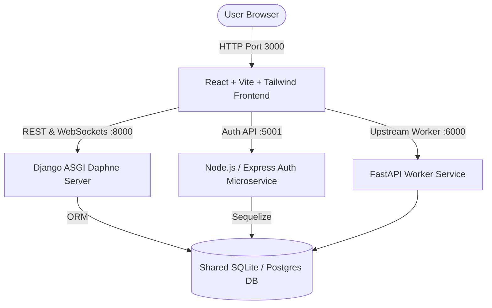

# HealNSight — Telemedicine Platform
## Complete Project Setup, Architecture & Operation Manual

> **Platform Overview:** HealNSight is a secure, end-to-end encrypted (E2EE) telemedicine platform designed for Bangladesh. It connects Patients, Certified Doctors, and System Administrators with digital consultations, real-time WebRTC audio/video rooms, encrypted medical records, verifiable digital prescriptions with auto PDF generation, medicine ordering, and security audit ledgers.

---

## 1. System Architecture & Tech Stack



### Components:
1. **Frontend (`frontend-src/` & `frontend/`):**
   - React 18, Vite 5, Tailwind CSS, Lucide Icons, Framer Motion.
   - Dual-language support (English & Bengali / বাংলা).
   - Silent notifications (popup toasts without audio chiming).
   - WebRTC pre-call camera & mic diagnostic visualizers.
2. **Backend API (`backend/`):**
   - Python Django 4.2 LTS, Daphne ASGI server, Django Channels (WebSockets).
   - E2EE record encryption, role-based access control (RBAC), cryptographic audit ledger.
   - SSLCommerz payment integration stubs, Twilio telephony simulation.
3. **Auth Microservice (`node-backend/`):**
   - Node.js, Express, Helmet, Sequelize.
   - Secure authentication, OTP verification, password recovery.
   - Intelligent port fallback (auto-uses port `5001` if macOS AirPlay holds port `5000`).
4. **FastAPI Worker (`fastapi-backend/`):**
   - Python FastAPI, Uvicorn, Pydantic v2.
   - High-throughput asynchronous upstream data worker on port `6000`.

---

## 2. Prerequisites

Ensure the following tools are installed on your machine:
* **Python**: Version 3.9+ (`python3 --version`)
* **Node.js**: Version 18+ or 20+ (`node --version`)
* **npm**: Version 9+ (`npm --version`)

---

## 3. Quick Start (Run in 1 Command)

The project includes automated runners that orchestrate the virtual environment, database migrations, seed data, and launch all 4 services concurrently.

### Step 1: Open Terminal in Project Root
```bash
cd "/Users/mdniloy/Downloads/telehealth bangladesh"
```

### Step 2: Initialize Database & Seed Demo Data
```bash
python3 run_migrations.py
```
*This command creates the SQLite database (`db.sqlite3`), creates schema tables, and populates mock doctors, patients, records, appointments, and medicine catalog.*

### Step 3: Start All Servers
```bash
python3 run_all.py
```

### Step 4: Access Applications in Your Browser
* **Frontend Web App:** [http://localhost:3000](http://localhost:3000)
* **Django Backend API:** [http://127.0.0.1:8000](http://127.0.0.1:8000)
* **Node.js Auth API:** [http://localhost:5001](http://localhost:5001)
* **FastAPI Worker Docs:** [http://127.0.0.1:6000/docs](http://127.0.0.1:6000/docs)

### Step 5: Stopping the Project
Press `Ctrl + C` in the terminal where `python3 run_all.py` is running. All subprocesses will gracefully terminate.

---

## 4. Manual Setup & Individual Execution (Step-by-Step)

If you prefer running services in separate terminal windows for isolated debugging:

### Terminal 1 — Django ASGI Backend
```bash
cd "telehealth-bangladesh"
# Activate the existing virtual environment:
source .venv/bin/activate
cd backend
python manage.py migrate
python manage.py seed_data
python manage.py runserver 127.0.0.1:8000 --noreload
```

### Terminal 2 — Node.js Auth Microservice
```bash
cd "telehealth-bangladesh/node-backend"
# Run with PORT=5001 to avoid macOS AirPlay conflict:
PORT=5001 node src/server.js
```

### Terminal 3 — FastAPI Upstream Worker
```bash
cd "telehealth-bangladesh"
source .venv/bin/activate
cd fastapi-backend
uvicorn main:app --host 127.0.0.1 --port 6000
```

### Terminal 4 — React Vite Frontend
```bash
cd "telehealth-bangladesh/frontend-src"
# Set environment variables and run Vite dev server:
VITE_API_BASE=http://localhost:8000 VITE_AUTH_API_BASE=http://localhost:5001 VITE_FASTAPI_BASE=http://localhost:6000 npx vite --port 3000 --host 0.0.0.0
```

---

## 5. Demo Login Credentials

On the login screen ([http://localhost:3000](http://localhost:3000)), first **click the role card** (Patient, Doctor, or Admin), then input the credentials:

| Role | Username | Password | Notes |
| :--- | :--- | :--- | :--- |
| **Doctor** | `sarah` | `password123` | Dr. Sarah Jenkins (General Medicine) — Approved |
| **Doctor** | `zara` | `password123` | Dr. Zara Ahmed (Cardiology) — Approved |
| **Doctor** | `kamal` | `password123` | Dr. Kamal Islam (ENT) — Approved |
| **Doctor** | `sukarna` | `password123` | Dr. Sukarna Roy (Medicine) — Pending Verification |
| **Patient** | `sadia` | `password123` | Sadia Kader (Active E2EE Consultation) |
| **Patient** | `niloy` | `password123` | Niloy Hasan (Active E2EE Records) |
| **Patient** | `rakib` | `password123` | Rakib Hasan |
| **Patient** | `farhan` | `password123` | Farhan Yeasmin |
| **Patient** | `nasir` | `password123` | Kazi Nasir |
| **System Admin** | `admin1` | `password123` | Full access to audit log & doctor KYC |
| **System Admin** | `admin2` | `password123` | Secondary Admin |

### Bypass & Verification Codes:
* **SMS / Email OTP Code:** `123456`
* **Email Magic Link Simulation:** Automatically resolves 2 seconds after dispatch.

---

## 6. Key Features & Walkthrough

### A. Patient Workflow
1. Log in as `niloy` or `sadia`.
2. **Find Doctors:** Navigate to *Find a Doctor & Specialty Directory* to view approved specialists, consulting hours, and fees.
3. **Consultation Room:** Join audio/video consultation sessions with camera and microphone testing before entry.
4. **Health Records:** Upload or inspect end-to-end encrypted records.
5. **Consent Manager:** Delegate or revoke doctor access to specific encrypted medical documents.
6. **Pharmacy:** Browse medicines (e.g. *Napa Extend*, *Seclo*, *Fexo*) and place delivery orders.

### B. Certified Doctor Workflow
1. Log in as `sarah` or `zara`.
2. **Queue & Appointments:** Review pending, approved, and live consultation sessions.
3. **E-Prescription Desk:** Create dynamic digital prescriptions (Medication name, Dosage, Duration, Instructions). When saved, a PDF version automatically downloads to the browser.
4. **Clinical Schedule:** Manage weekly available days, timeslots, and consultation fees.

### C. System Administrator Workflow
1. Log in as `admin1`.
2. **Doctor KYC Center:** Review uploaded BMDC certificates, inspect national IDs, and approve/reject doctor accounts.
3. **Security Ledger & Audit Logs:** View tamper-evident cryptographic access logs generated whenever doctors inspect medical files.
4. **Staff Management:** Assign and review administrative staff permissions.

### D. Audio & Sound Policy
* All intrusive audio ringtones and notification chime sounds are **disabled globally**.
* Popup toasts appear cleanly and silently without sound.

---

## 7. Troubleshooting & FAQ

### Issue: "Port 5000 is already in use"
* **Reason:** macOS Monterey, Ventura, Sonoma, and Sequoia bind the system AirPlay Receiver to port 5000 (`ControlCenter`).
* **Solution:** The project automatically detects this and binds the Node.js auth service to port `5001`. The frontend is automatically configured to use port `5001`.

### Issue: "ModuleNotFoundError: No module named 'django'"
* **Solution:** Always run with the virtual environment Python:
  ```bash
  telehealth-bangladesh/.venv/bin/python manage.py <command>
  ```
  The root scripts `python3 run_all.py` and `python3 run_migrations.py` automatically detect and use `.venv`.

### Issue: "Vite App.jsx 500 Internal Server Error"
* **Solution:** Run `npm run build` inside `telehealth-bangladesh/frontend-src/` to verify syntax. If any syntax error occurs, Vite will report the line number. All files are verified with 0 syntax errors.

---

## 8. Directory Structure Summary

```
telehealth bangladesh/
├── INSTRUCTIONS.md               <-- This Instruction Document
├── README.txt                    <-- Additional project notes
├── run_all.py                    <-- Root one-click runner for all 4 services
├── run_migrations.py             <-- Root database migrator & seeder
└── telehealth-bangladesh/
    ├── .venv/                    <-- Python virtual environment (Django, FastAPI, Web3)
    ├── backend/                  <-- Django Daphne ASGI server & models
    │   ├── db.sqlite3            <-- Shared SQLite database
    │   ├── api/                  <-- Telemedicine REST API views & serializers
    │   └── otp_security/         <-- OTP security & cryptographic audit
    ├── node-backend/             <-- Node.js Express Authentication Microservice
    ├── fastapi-backend/          <-- FastAPI Upstream Worker
    ├── frontend-src/             <-- React + Vite source code
    │   ├── src/components/       <-- Portals (Doctor, Patient, Admin, Clinical Room)
    │   └── package.json          <-- Frontend npm dependencies
    └── frontend/                 <-- Compiled production distribution
```
