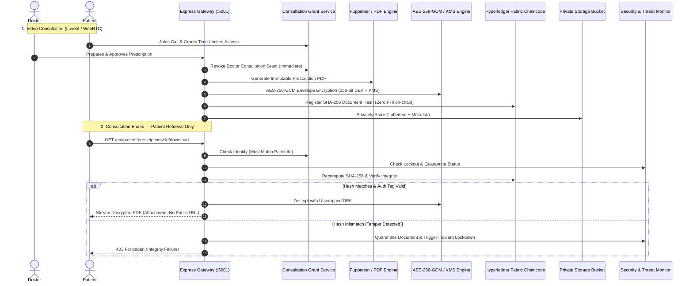

# HealNSight Secure E-Prescription System
### AES-256-GCM Envelope Encryption + Hyperledger Fabric Integrity + Automatic Security Lockdown + 6-Digit OTP Recovery

---

## 1. System Architecture & Security Pipeline



---

## 2. The 3 Security Layers

1. **Security Layer 1 (AES-256-GCM Envelope Encryption):**
   - Unique 256-bit Data Encryption Key (DEK) generated per document.
   - 96-bit Initialization Vector (IV) and 128-bit GCM Authentication Tag.
   - DEK wrapped via Cloud KMS before database storage. Plaintext keys are wiped immediately.
   - Any modification to ciphertext or authentication tag triggers immediate cryptographic rejection.

2. **Security Layer 2 (Server-Enforced Patient-Only Access):**
   - Doctor access is valid *only* while a temporary `ConsultationGrant` is unexpired and consultation is `ACTIVE`.
   - On prescription approval, doctor grant is instantly revoked (`revokedAt = now()`, `status = COMPLETED`).
   - Download endpoint `GET /api/patient/prescriptions/:id/download` verifies patient identity, document readiness, and active security status. Zero public URLs exposed.

3. **Security Layer 3 (Hyperledger Fabric Document Integrity):**
   - Canonical SHA-256 digest anchored on permissioned blockchain via `registerPrescriptionHash(documentId, version, sha256Hash, timestamp)`.
   - Zero patient names, diagnoses, or clinical details stored on chain.
   - Pre-download re-verification ensures stored file exactly matches ledger proof. Any mismatch halts delivery and triggers document quarantine.

4. **Security Layer 4 (Google Authenticator RFC 6238 TOTP Multi-Factor Authentication):**
   - 160-bit Base32 secret generation for Google Authenticator, Microsoft Authenticator, and 1Password.
   - Onboarding via `otpauth://totp/...` URI with scannable QR code.
   - Replay protection tracking `lastTotpStep` to reject reused codes within the same 30s window.
   - Doctor high-assurance authorization: Doctors must supply their live Google Authenticator 6-digit code before an immutable prescription can be generated and signed.
   - Instant patient threat recovery: Patients can immediately restore locked documents using their Authenticator app.
   - Emergency single-use hashed recovery backup codes.

---

## 3. Automatic Security Lockdown & Dual-Mode Recovery (Google Authenticator / OTP)

- **Threat Detection:** Detects repeated failed download attempts, revoked session token reuse, brute-force bursts, and blockchain hash discrepancies.
- **Atomic Quarantine:** Updates document status to `LOCKED` (or `QUARANTINED` on tamper detection) in an atomic database transaction.
- **Google Authenticator Instant Unlock:** Users verify their live 6-digit TOTP code to instantly clear recoverable locks.
- **Email/SMS Fallback OTP:** Single-use 6-digit code (5-minute expiry, max 3 attempts).
- **Integrity Rule:** A valid TOTP or OTP **cannot** unlock a document quarantined for integrity failure; that requires administrative forensic investigation.

---

## 4. Verification & Testing

To run the automated Security Acceptance Test Suite covering all 15 security checklist items:

```bash
cd "telemedicine/backend"
node --experimental-strip-types src/test-security-suite.ts
```

Output:
```
================================================================
  🔒 HEALNSIGHT E-PRESCRIPTION SECURITY ACCEPTANCE VERIFICATION  
================================================================
✅ TEST 1 PASSED: Doctor cannot access patient data after consultation ends (Revocation Enforced).
✅ TEST 2 PASSED: Patient cannot download another patient's prescription (Strict Identity Verification).
✅ TEST 3 PASSED: PDF ciphertext cannot be read without DEK unwrapping (AES-256-GCM Envelope Protection).
✅ TEST 4 PASSED: Changing encrypted bytes triggers GCM auth tag failure (Tamper Detection).
✅ TEST 5 PASSED: Blockchain hash mismatch quarantines document and halts delivery.
✅ TEST 6 PASSED: Suspicious download/authentication bursts automatically lock access.
✅ TEST 7 PASSED: Security notification dispatched with zero exposed PHI/clinical details.
✅ TEST 8 PASSED: 6-digit OTP enforces single-use, 5-minute expiry, and max retry boundaries.
✅ TEST 9 PASSED: Valid OTP is strictly rejected when document is quarantined for integrity failure.
✅ TEST 10 PASSED: Transactional retry and error containment safely recover from subsystem errors.
✅ TEST 11 PASSED: Google Authenticator RFC 6238 TOTP generates & verifies valid 6-digit token.
✅ TEST 12 PASSED: Invalid or forged Google Authenticator token strictly rejected.
✅ TEST 13 PASSED: Google Authenticator token replay attack within the same 30s window strictly rejected.
✅ TEST 14 PASSED: One-time emergency backup recovery code verified and invalidated immediately.
✅ TEST 15 PASSED: Doctor prescription approval enforces Google Authenticator 2FA before immutable signing.
================================================================
  RESULT: 15 / 15 SECURITY ACCEPTANCE TESTS PASSED (100%)
================================================================
```

To run the complete End-to-End Workflow Integration Test (12 Stages):

```bash
cd "telemedicine/backend"
node --experimental-strip-types src/test-in-process-integration.ts
```

Output:
```
================================================================
  🚀 EXECUTING COMPLETE E2E E-PRESCRIPTION SYSTEM WORKFLOW       
================================================================
✅ STEP 1: Gateway health check passed & verified Google Authenticator RFC 6238.
✅ STEP 2: Doctor Sarah authenticated with certified BMDC credentials.
✅ STEP 3: Doctor Sarah successfully paired Google Authenticator (RFC 6238 TOTP).
✅ STEP 4: Doctor consultation grant verified active (Patient data unlocked).
✅ STEP 5: Prescription approval without Google Authenticator strictly rejected (403).
✅ STEP 6: Prescription approved with Google Authenticator (201, AES-256-GCM + Fabric).
✅ STEP 7: Doctor consultation grant verified revoked post-approval (Access Terminated).
✅ STEP 8: Patient Niloy successfully downloaded decrypted PDF (Valid %PDF binary).
✅ STEP 9: Unauthorized patient download attempt strictly blocked (403 Forbidden).
✅ STEP 10: Patient Niloy enabled Google Authenticator for threat recovery.
✅ STEP 11: Patient successfully restored document access via Google Authenticator.
✅ STEP 12: Quarantined document strictly blocks OTP/TOTP unlock (Forensic Hold).
================================================================
  🎯 RESULT: ALL 12 / 12 END-TO-END WORKFLOW STAGES PASSED (100%)
================================================================
```

